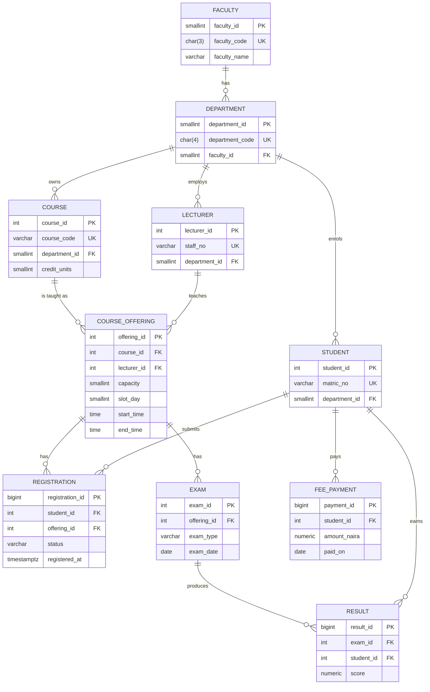

# Advanced Database Systems Portfolio

**Student:** Sharon Chibuzor Mbionwu
**Matric number:** 2026/A/MIT/0060
**Programme:** MIT, Miva Open University
**Cohort:** September 2026
**Course:** MIT 8103 — Advanced Database Systems
**Database name (used in every script):** `ststephen`

---

## 1. Case study — St. Stephen Private University Student Management System

### 1.1 Organisation

St. Stephen Private University is a fictional Nigerian private university
located in Enugu, Enugu State. It runs standard four-year undergraduate
programmes organised into faculties, departments and courses, with two
main semesters (`FIRST`, `SECOND`) and a short `SUMMER` semester. Each
course is taught in a course offering for a particular semester and
academic year, with a fixed weekly time slot and an enrolment capacity
that reflects the size of the lecture hall.

Tuition and other charges are billed per academic session in Naira
(NGN). The University does **not** model hostels, room allocation or
examination seat allocation in this portfolio (other students in the
cohort cover those scenarios).

### 1.2 Users

| User role | What they do in the system |
| --- | --- |
| Registrar | Creates faculties, departments, lecturers, students and courses; opens course offerings; sets capacities. |
| Lecturer | Teaches one or more course offerings; cannot be double-booked into clashing time slots. |
| Student | Registers for course offerings; sits examinations; pays tuition. |
| Bursar | Records fee payments in Naira; reconciles payments against registrations. |
| Examination officer | Records examination scores only for students who are actively registered. |

### 1.3 Data

The relational schema (in `portfolio-1-database-design/01_schema.sql`)
contains ten tables in third normal form:

- `faculty` — academic faculties (Science, Engineering, Management Sciences, Arts).
- `department` — departments belonging to a faculty.
- `lecturer` — academic staff attached to a department.
- `student` — matriculated students attached to a department.
- `course` — courses owned by a department, with credit units and level.
- `course_offering` — a course taught in a specific semester and academic year, with capacity, lecturer and weekly time slot.
- `registration` — a student registered for an offering (`ACTIVE`, `DROPPED` or `COMPLETED`).
- `exam` — an exam attached to an offering (`CA`, `MIDSEM`, `FINAL`, `RESIT`).
- `result` — a student's score for an exam.
- `fee_payment` — a tuition payment in Naira for a student in a session.

The MongoDB portfolio (`portfolio-4-nosql`) keeps a flexible
`course_catalogue` (rich syllabus documents whose structure varies per
faculty) and `exam_attempts` (high-volume student activity log).

### 1.4 Operations

- Open a course offering, set its capacity and weekly slot, and assign a lecturer.
- Register a student for an offering (subject to capacity and to the
  one-active-registration-per-student-per-offering rule).
- Drop or complete a registration.
- Schedule an exam on an offering and record a result for a registered student.
- Record a fee payment and compute fees owed (derived from registrations × credit units × rate minus payments — not typed in).
- Report on GPA, pass rate per department / course / lecturer, and last 30 days of activity.
- Partition the high-volume `registration` table by month for cloud-scale reporting.

### 1.5 Integrity rules enforced

- Primary, foreign-key, `UNIQUE` and `CHECK` constraints on every table.
- A **partial UNIQUE index** that allows only one `ACTIVE` registration per `(student_id, offering_id)` — `DROPPED`/`COMPLETED` rows do not count.
- Three `BEFORE` triggers:
  1. `enforce_capacity` — refuses a new `ACTIVE` registration once an offering is full.
  2. `enforce_result_registered` — refuses a `result` for a student with no `ACTIVE` registration on the exam's offering.
  3. `enforce_no_lecturer_clash` — refuses a course offering that would put a lecturer in two overlapping weekly time slots.
- No `CHECK` constraint uses `CURRENT_DATE`; every date sanity rule that depends on "today" is a trigger.

---

## 2. Repository structure

```
advanced-database-portfolio/
├── README.md                                  (this file)
├── portfolio-1-database-design/
│   ├── 01_schema.sql                          10 tables, PK/FK/UNIQUE/CHECK, partial UNIQUE index, 3 triggers
│   ├── 02_indexes.sql                         FK indexes used by triggers and reports
│   ├── 03_seed_data.sql                       Small realistic Nigerian seed
│   ├── 04_bulk_data.sql                       50–100k registrations via generate_series
│   ├── 05_constraint_tests.sql                10 BEGIN…ROLLBACK tests + 1 control
│   └── README.md
├── portfolio-2-query-optimisation/
│   ├── 01_queries.sql                         8 queries (4 selective, 4 aggregates)
│   ├── 02_explain_analyze.sql                 Drops P2 indexes → EXPLAIN → recreates → EXPLAIN
│   └── README.md
├── portfolio-3-transactions-concurrency/
│   ├── 01_transactions.sql                    Commit / rollback / SAVEPOINT recovery
│   ├── race_demos.py                          6 labelled parts, two real psycopg2 sessions
│   └── README.md
├── portfolio-4-nosql/
│   ├── 01_setup.js                            Collections with $jsonSchema validators
│   ├── 02_data_and_queries.js                 Seed + 3 aggregation pipelines
│   ├── 03_bulk_and_index_demo.js              40k docs, COLLSCAN vs compound index
│   └── README.md
├── portfolio-5-distributed-cloud/
│   ├── 01_partitioning.sql                    Monthly RANGE partitions via DO loop + DEFAULT
│   ├── cloud_design.md                        Multi-AZ managed DB, NDPA 2023, CBN notes
│   └── README.md
└── docs/
    └── REFERENCES.md
```

Added during testing (see `CHANGES.md`): `setup.sh` (one-time setup), `runall.sh`
(runs Portfolio 1 to 5 in order, commits after each), `collect_results.sh`
(writes `my_results.txt`), and the P5 replica files `02_replica_setup.sh` and
`03_replica_tests.sql`.

---

## 3. Entity–relationship diagram (key columns only)



---

## 4. AI-use note

Drafted by Z.ai; tested and fixed by Claude; run by the student.
